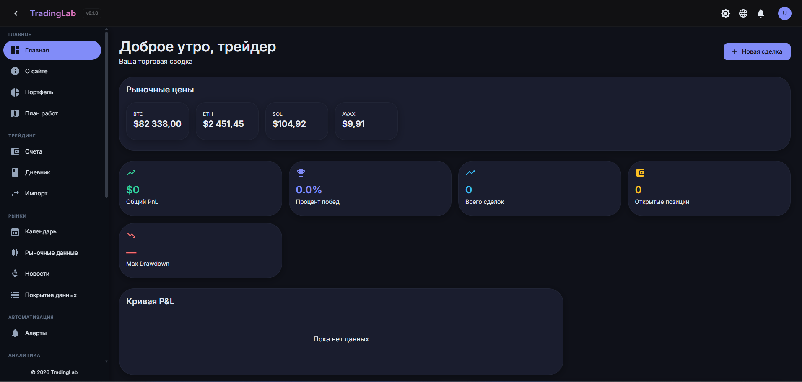
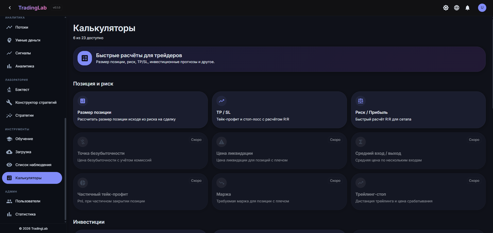

```markdown


# TradingLab

> Микросервисная платформа для алгоритмического трейдинга, трейдинг-журнала и on-chain аналитики.

## Скриншоты

### Дашборд


### Калькуляторы


### Покрытие данных


---

## О проекте

TradingLab — это персональная торговая платформа, объединяющая трейдинг-журнал, движок бэктестинга, инструменты автоматизации и аналитику в одном месте. Проект родился из желания иметь единый инструмент вместо десятка разрозненных сервисов, таблиц и блокнотов.

Платформа построена как набор из **15 независимых микросервисов** на .NET 8 с чистой архитектурой внутри каждого. Взаимодействие между сервисами — как синхронное (HTTP), так и асинхронное (RabbitMQ + MassTransit). Ключевые сценарии — событийно-ориентированные: регистрация пользователя, блокировка, создание сделки, срабатывание алерта — всё это публикует события, на которые подписаны другие сервисы.

Чем TradingLab отличается от типичного пет-проекта: это не CRUD-приложение и не «Todo List». Это **распределённая система** с реальными инженерными задачами — идемпотентность событий, отказоустойчивость HTTP-клиентов, dead letter queue, распределённый трейсинг, CI/CD, интеграционные тесты на Testcontainers. Проект развивается по принципу «инженерная работа прежде всего» и служит одновременно инструментом для торговли и площадкой для отработки архитектурных практик.

---

## Стек

**Backend:**
- .NET 8, ASP.NET Core
- PostgreSQL 16, EF Core
- RabbitMQ + MassTransit (event-driven)
- Redis (кэширование)
- Hangfire (фоновые задачи)
- FluentValidation (валидация)
- Serilog + Seq (логирование)

**Frontend:**
- React 19, TypeScript
- MUI (Material-UI)
- Vite
- Recharts + lightweight-charts
- React Router, i18next (EN/RU)

**Infrastructure:**
- Docker, Docker Compose
- GitHub Actions (CI/CD)
- Prometheus + Grafana (метрики)
- Seq (централизованные логи)
- pgAdmin (управление БД)

---

## Архитектура

TradingLab построен как **микросервисная система** с API Gateway (YARP) на входе. Каждый сервис имеет чистую архитектуру внутри:

- **Api** — контроллеры, DI, Program.cs
- **Application** — сервисы, валидаторы, DTO, интерфейсы
- **Domain** — сущности, енумы, доменные исключения, бизнес-логика
- **Infrastructure** — репозитории, DbContext, HTTP-клиенты

```mermaid
graph TB
    FE[Frontend<br/>React 19 + TS + MUI]
    GW[API Gateway<br/>YARP Reverse Proxy]

    FE -->|HTTP/HTTPS| GW

    GW --> Auth[Auth Service]
    GW --> Journal[Journal Service]
    GW --> Portfolio[Portfolio Service]
    GW --> Calendar[Calendar Service]
    GW --> Alerts[Alerts Service]
    GW --> Backtest[Backtest Service]
    GW --> BotEngine[BotEngine Service]
    GW --> Exchange[Exchange Service]
    GW --> MarketData[MarketData Service]
    GW --> DataIngestion[DataIngestion Service]
    GW --> Analytics[Analytics Service]
    GW --> Notification[Notification Service]
    GW --> Settings[Settings Service]
    GW --> Audit[Audit Service]
    GW --> Admin[Admin Service]
    GW --> Indicators[Indicators Service]

    subgraph "Инфраструктура"
        PG[(PostgreSQL)]
        RQ[RabbitMQ]
        RD[(Redis)]
        SQ[Seq]
        PM[Prometheus]
        GF[Grafana]
    end

    Auth --> PG
    Journal --> PG
    Portfolio --> PG
    Backtest --> PG
    MarketData --> PG
    Notification --> RQ
    Audit --> RQ
    Indicators --> RQ

### Взаимодействие сервисов

**Синхронное (HTTP):**
- Frontend → Gateway → Services
- Admin → Auth (управление пользователями)
- Portfolio → MarketData (текущие цены)
- Backtest → MarketData (исторические свечи)
- Backtest → ML Service (оптимизация параметров)

**Асинхронное (RabbitMQ + MassTransit):**
- Auth → Audit (события регистрации, входа, блокировки)
- Alerts → Notification (срабатывание алерта)
- BotEngine → Notification (запуск, остановка бота)
- Exchange → Notification (завершение импорта)
- MarketData → Indicators (новые свечи)

---

## Что уже реализовано

- ✅ **15 микросервисов** с чистой архитектурой
- ✅ **API Gateway** на YARP с единым входом для всех сервисов
- ✅ **Аутентификация и авторизация**: JWT, refresh-токены, роли, детальные permissions
- ✅ **Трейдинг-журнал**: счета, позиции, сделки, теги, заметки, коррекции
- ✅ **Бэктестинг**: RSI, SMA Crossover, визуальный конструктор стратегий, метрики (Sharpe, max drawdown, profit factor)
- ✅ **Event-driven архитектура** через RabbitMQ + MassTransit
- ✅ **Фоновые задачи** на Hangfire (проверка алертов, ingestion, боты)
- ✅ **Интеграция с Bybit** для импорта сделок
- ✅ **Загрузка исторических данных** с Binance
- ✅ **Индикаторы и сигналы**: EMA20/50/200, RSI, MACD, multi-timeframe анализ
- ✅ **Двойная локализация** EN/RU
- ✅ **Контейнеризация** через Docker Compose
- ✅ **Health checks, метрики Prometheus, централизованные логи** в Seq
- ✅ **Unit-тесты** в ключевых сервисах (Auth, Journal, Alerts, Backtest)

### В активной разработке

- 🚧 **CI/CD** на GitHub Actions (сборка, тесты, публикация Docker-образов)
- 🚧 **Интеграционные тесты** на Testcontainers
- 🚧 **Event-driven** для CRUD-операций (сейчас только для уведомлений)
- 🚧 **NuGet-пакеты** для переиспользования общих модулей
- 🚧 **Real-time интеграция** с биржей (Bybit testnet)

---

## Как запустить

### Требования

- Docker Desktop 4.x+
- Docker Compose v2+
- 8 GB RAM (минимум), 16 GB рекомендуется
- 10 GB свободного места

---

## Статус

Проект находится в **активной разработке**. Обновления выходят регулярно.

Код проекта **не опубликован** в открытом доступе, так как содержит уникальные алгоритмы и может быть использован коммерчески.

Код доступен по запросу для потенциальных работодателей и партнёров:
- 📧 Email: sharf_ti@mail.ru
- 💬 Telegram: @sharf_tim
- 🔗 LinkedIn: [твой профиль, если есть]

---

## Документация

- [Архитектура](docs/ARCHITECTURE.md) — подробное описание системы, сервисов, взаимодействий
- [Сервисы](docs/SERVICES.md) — порты, URL, конфигурация каждого сервиса (пока не заполнен)

---

## Лицензия

Проект является приватным. Все права защищены.

---

## Контакты

**Тимур Шарафутдинов** — C#/.NET Backend Developer

- Email: sharf_ti@mail.ru
- Telegram: @sharf_tim
- GitHub: [github.com/Tim882](https://github.com/Tim882)
```
