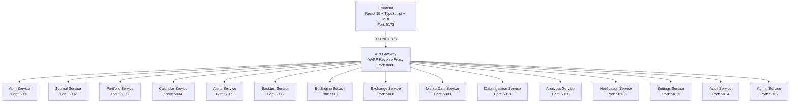
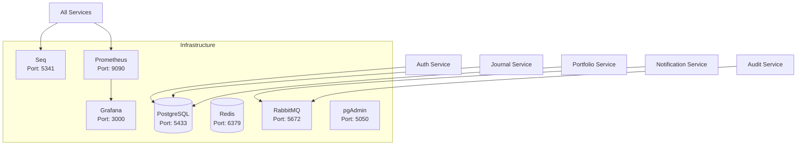
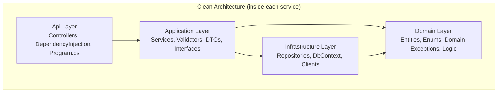
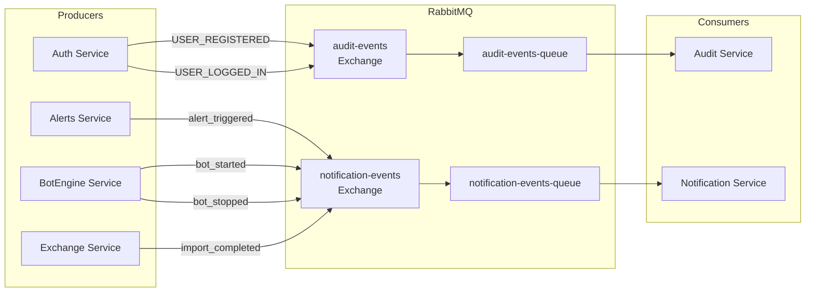
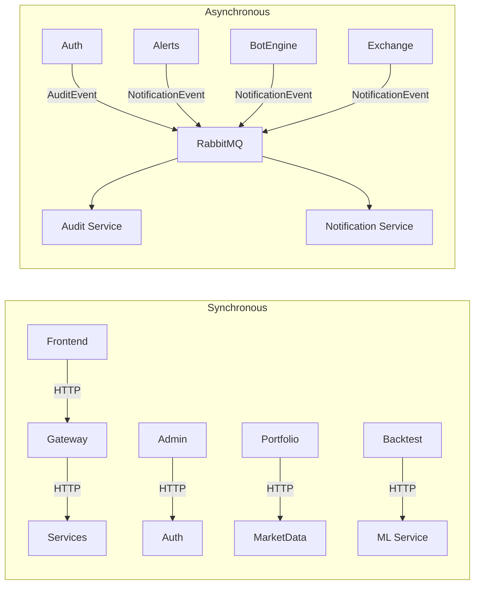

# TradingLab Architecture

## Overview

TradingLab — персональная платформа для алгоритмического трейдинга, ончейн-аналитики и управления портфелем.

## Architecture Style

**Microservices Architecture** с чистой архитектурой внутри каждого сервиса.

---

## Обновлённая документация с Mermaid диаграммами

## System Diagram



---

## Infrastructure



---

## Clean Architecture



---

## Message Bus (RabbitMQ + MassTransit)



---

## Shared Library

| Module | Description | Key Components |
|--------|-------------|----------------|
| **Api** | Response wrapping, base controller | ApiResponseFilter |
| **Auth** | JWT, permissions, roles | RequirePermissionAttribute, PermissionPolicyProvider |
| **CORS** | CORS configuration | AddTradingLabCors |
| **Data** | Repository pattern, Unit of Work | BaseRepository, IBaseRepository, UnitOfWork |
| **ErrorHandling** | Exception handling, controller helpers | TradingLabExceptionHandler, ControllerExtensions |
| **Exceptions** | Domain exceptions, error codes | DomainException, ApiException, ErrorCodes |
| **Extensions** | Common helpers | DateTime, String, Decimal, Collection, Enum, Guid |
| **HealthChecks** | Health check configuration | AddTradingLabHealthChecks |
| **Logging** | Serilog + Seq, request logging | LoggingExtensions, RequestLoggingMiddleware |
| **Messaging** | MassTransit, RabbitMQ events | MassTransitExtensions, AuditEvent, NotificationEvent |
| **Monitoring** | Prometheus metrics | AddTradingLabMetrics |
| **Pagination** | Pagination helpers | PagedResult, QueryableExtensions |
| **Retry** | Retry policy for external APIs | RetryPolicy |
| **Swagger** | Swagger configuration | AddTradingLabSwagger |
| **Validation** | Common validators | CommonValidators |

---

## Communication Patterns



---

## Service Details

### Auth Service (5001)
- **Назначение:** Аутентификация, авторизация, роли
- **БД:** tradinglab_auth
- **Особенности:** ASP.NET Identity, JWT, Permissions

### Journal Service (5002)
- **Назначение:** Трейды, позиции, счета, заметки, watchlist
- **БД:** tradinglab_journal
- **Особенности:** Доменные сущности с бизнес-логикой

### Portfolio Service (5003)
- **Назначение:** Инвестиционные портфели, холдинги, транзакции
- **БД:** tradinglab_portfolio

### Calendar Service (5004)
- **Назначение:** Экономический календарь, события
- **БД:** tradinglab_calendar

### Alerts Service (5005)
- **Назначение:** Ценовые алерты, уведомления
- **БД:** tradinglab_alerts

### Backtest Service (5006)
- **Назначение:** Бэктестинг стратегий (RSI, SMA, Generic)
- **БД:** tradinglab_backtest
- **Особенности:** Подключается к ML Service для оптимизации

### BotEngine Service (5007)
- **Назначение:** Торговые боты (DCA, Grid, Momentum)
- **БД:** tradinglab_botengine
- **Особенности:** Hangfire для фоновых задач

### Exchange Service (5008)
- **Назначение:** Интеграция с биржами (Bybit, Binance)
- **БД:** tradinglab_exchange
- **Особенности:** Импорт трейдов

### MarketData Service (5009)
- **Назначение:** Хранение свечей, рыночные данные
- **БД:** tradinglab_marketdata
- **Особенности:** Hangfire для обновления данных

### DataIngestion Service (5010)
- **Назначение:** Загрузка данных с бирж
- **БД:** tradinglab_dataingestion
- **Особенности:** Многопоточная загрузка, прогресс

### Analytics Service (5011)
- **Назначение:** Ончейн-аналитика, Smart Money
- **БД:** tradinglab_analytics

### Notification Service (5012)
- **Назначение:** Уведомления (in-app, Telegram, Email)
- **БД:** tradinglab_notification
- **Особенности:** RabbitMQ Consumer, SignalR

### Settings Service (5013)
- **Назначение:** Настройки пользователя, API ключи
- **БД:** tradinglab_settings

### Audit Service (5014)
- **Назначение:** Аудит действий
- **БД:** tradinglab_audit
- **Особенности:** RabbitMQ Consumer (планируется)

### Admin Service (5015)
- **Назначение:** Администрирование пользователей
- **БД:** нет (агрегатор)
- **Особенности:** HTTP клиенты к Auth/Audit

### ML Service (8000)
- **Назначение:** ML модели (оптимизация, скоринг)
- **БД:** нет
- **Особенности:** Python FastAPI

---

## Communication Patterns

### Синхронные (HTTP):
- Frontend → Gateway → Services
- Admin Service → Auth Service
- Portfolio Service → MarketData Service
- Backtest Service → ML Service

### Асинхронные (RabbitMQ):
- Alerts → Notification (alert_triggered)
- BotEngine → Notification (bot_started, bot_stopped)
- Exchange → Notification (import_completed)
- Auth → Audit (планируется)
- Journal → Audit (планируется)

---

## Security

### Аутентификация:
- JWT Bearer Tokens
- Refresh Tokens
- ASP.NET Identity

### Авторизация:
- Роли: User, Moderator, Admin, SuperAdmin
- Permissions: детальные права
- RequirePermissionAttribute

### Хранение секретов:
- Environment Variables в Docker
- appsettings.json для разработки
- Шифрование API ключей (планируется)

---

## Monitoring

### Health Checks:
- `/health` — полная проверка
- `/health/live` — жив ли сервис
- `/health/ready` — готов ли к работе

### Metrics (Prometheus):
- HTTP запросы
- Ошибки
- Задержки

### Logging (Seq):
- Структурированные логи
- TraceId для отслеживания
- Поиск и фильтрация

### Dashboards (Grafana):
- HTTP Requests Rate
- HTTP Errors
- Services Status

---

## Deployment

### Docker Compose:
- Все сервисы в контейнерах
- PostgreSQL, RabbitMQ, Redis, Seq
- Prometheus, Grafana
- Порты: 5001-5015, 8080, 8000

### CI/CD (планируется):
- GitHub Actions
- Автоматические тесты
- Автодеплой

---

## Database Naming

Базы данных: `tradinglab_{service_name}`

| Сервис | БД |
|--------|-----|
| Auth | tradinglab_auth |
| Journal | tradinglab_journal |
| Portfolio | tradinglab_portfolio |
| Calendar | tradinglab_calendar |
| Alerts | tradinglab_alerts |
| Backtest | tradinglab_backtest |
| BotEngine | tradinglab_botengine |
| Exchange | tradinglab_exchange |
| MarketData | tradinglab_marketdata |
| DataIngestion | tradinglab_dataingestion |
| Analytics | tradinglab_analytics |
| Notification | tradinglab_notification |
| Settings | tradinglab_settings |
| Audit | tradinglab_audit |

---

## Message Bus (RabbitMQ + MassTransit)

### Exchanges

| Exchange | Type | Purpose |
|----------|------|---------|
| audit-events | fanout | Audit events from all services |
| notification-events | fanout | Notification events from all services |

### Queues

| Queue | Consumer | Purpose |
|-------|----------|---------|
| audit-events-queue | Audit Service | Processes audit events |
| notification-events-queue | Notification Service | Processes notification events |

### Events

#### AuditEvent
```json
{
  "action": "USER_REGISTERED",
  "userId": "guid",
  "serviceName": "Auth",
  "details": "User registered",
  "ipAddress": "127.0.0.1",
  "timestamp": "2026-08-31T10:00:00Z"
}
```

#### NotificationEvent
```json
{
  "type": "alert_triggered",
  "userId": "guid",
  "title": "Alert: BTC",
  "body": "BTC above 50000",
  "channels": ["inapp"]
}
```

### Producers

| Service | Events Published |
|---------|-----------------|
| Auth | USER_REGISTERED, USER_LOGGED_IN |
| Alerts | alert_triggered |
| BotEngine | bot_started, bot_stopped |
| Exchange | import_completed |

### Consumers

| Service | Events Consumed |
|---------|-----------------|
| Audit | AuditEvent (all) |
| Notification | NotificationEvent (all) |

---

## Communication Patterns

### Synchronous (HTTP):
- Frontend → Gateway → Services
- Admin Service → Auth Service (users, stats)
- Portfolio Service → MarketData Service (prices)
- Backtest Service → ML Service (optimization)

### Asynchronous (RabbitMQ + MassTransit):
- Auth → Audit (USER_REGISTERED, USER_LOGGED_IN)
- Alerts → Notification (alert_triggered)
- BotEngine → Notification (bot_started, bot_stopped)
- Exchange → Notification (import_completed)

### Planned:
- Journal → Audit (trade_created, trade_deleted)
- Portfolio → Notification (rebalance_required)
- Admin → Audit (user_blocked, role_changed)
```

---